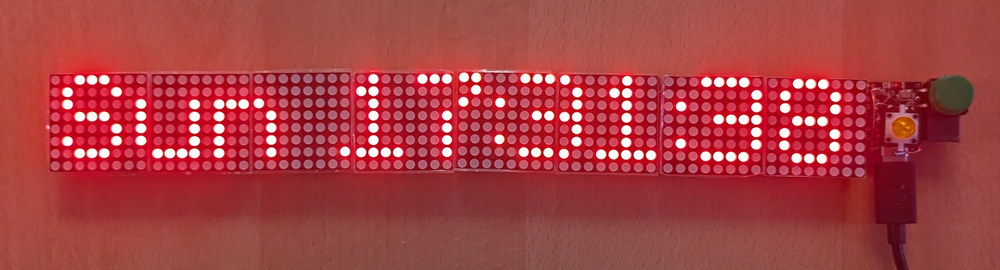

# Death Clock

A 64×8 LED matrix clock for Home Assistant, built on an ESP32-C3 and ESPHome. It has five display modes, two buttons, a piezo buzzer for alarms and an orange status LED.



## Hardware

| Part | Notes |
|---|---|
| ESP32-C3 Super Mini | |
| 8 × MAX7219 8×8 LED modules | Two 4-in-1 32×8 boards chained to 64×8, powered from 5V |
| 2 × momentary push buttons | Normally open |
| Passive piezo buzzer | Must be passive (no built-in oscillator) |
| Orange LED | Active low |

### Wiring

| Function | ESP32-C3 pin | Notes |
|---|---|---|
| Matrix CLK | GPIO3 | SPI clock |
| Matrix DIN | GPIO0 | SPI data (MOSI) |
| Matrix CS | GPIO4 | |
| Button 1 (mode) | GPIO21 ↔ GPIO10 | GPIO21 is held low, GPIO10 is an input with pull-up |
| Button 2 (action) | GPIO6 ↔ GPIO8 | GPIO6 is held low, GPIO8 is an input with pull-up |
| Piezo | GPIO7 ↔ GPIO20 | Push-pull drive, the two pins 180° out of phase |
| Orange LED | GPIO5 | Active low |

Hardware notes:

- **Buttons:** each button connects two GPIOs, one driven low and one read with a pull-up, so it needs no ground wire.
- **GPIO8:** this is a strapping pin and also drives the board's blue LED, so the blue LED lights while button 2 is pressed. GPIO6 is only driven low once the firmware is running, so pressing button 2 at power-up can't affect booting.
- **Piezo drive:** the piezo uses LEDC PWM channels 0 and 1, which share a hardware timer and run 180° apart. That gives about 6.6V peak to peak across the piezo, and both pins sit low when it's silent.
- **Wi-Fi power:** Wi-Fi transmit power is limited to 8.5 dB. At full power the Super Mini's antenna detunes and connections fail with "Auth Expired". Keep the antenna clear of wiring.

## Display modes

Button 1 cycles through the modes, or choose one from **Display Mode** in Home Assistant.

| Mode | Shows | Button 2 |
|---|---|---|
| Clock | `Sun 13:07:08` | Shows the date (`17 Oct 2026`) for 3 seconds |
| Timer | Kitchen timer, see below | Set, pause, resume, reset |
| Stopwatch | `MM:SS.t`, switching to `H:MM:SS.t` after an hour | Tap to start or stop, hold 1 s to reset |
| Countdown | Time left until a target time, e.g. `12d04h`, `05:30`, then `DEAD` | — |
| Text | A message from Home Assistant, scrolling if it's too long | — |

Timer, Stopwatch and Countdown modes show an icon at the far left: an hourglass, a stopwatch and a skull respectively.

### Kitchen timer

- **Setting:** with the display showing `timer`, each press of button 2 adds 5 minutes. Holding it adds time quickly. The maximum is 9:55:00.
- **Starting:** the timer starts 3 seconds after the last press, with a short beep.
- **Pausing and resetting:** while it's running, a press pauses or resumes, and the display blinks while paused. Holding for 1 second resets it.
- **When it expires:** the display switches to Timer mode, the alarm sounds for 30 seconds and the orange LED flashes. Button 2 silences it.

The timer keeps running while you use other modes.

### Alarm

The alarm repeats beep-beep-beep for 30 seconds, with the orange LED flashing in time. Trigger it from Home Assistant with the **Alarm** button (for example, in an automation that presses `button.death_clock_alarm`). Button 2 or **Alarm Stop** silences it.

All button presses give a short beep.

## Home Assistant

### Entities provided by the device

| Entity | Type |
|---|---|
| Display Mode | Select: Clock, Timer, Stopwatch, Countdown, Text |
| Matrix Brightness | Number, 0–15 |
| Matrix Power | Switch |
| Orange LED | Light |
| Stopwatch Start Stop, Stopwatch Reset | Buttons |
| Alarm, Alarm Stop | Buttons |

### Helpers the device reads

Countdown and Text modes read these Home Assistant helpers, so create them in Home Assistant:

```yaml
input_text:
  matrix_message:
    name: Matrix message
    max: 255

input_number:
  countdown_target_timestamp:
    name: Countdown target
    min: 0
    max: 4102444800
    step: 1
    mode: box
```

The countdown target is a Unix timestamp. For example, to set it from a date:

```yaml
action: input_number.set_value
target:
  entity_id: input_number.countdown_target_timestamp
data:
  value: "{{ as_timestamp('2027-01-01 00:00:00') }}"
```

The clock's time comes from Home Assistant.

## Software

- **Firmware:** ESPHome (built with 2026.9), ESP-IDF framework. Everything is in [`death_clock.yaml`](death_clock.yaml).
- **Font:** `lucasfont_alternate` from the [u8g2](https://github.com/olikraus/u8g2) font collection, downloaded at build time. It's a proportional pixel font with 7-pixel capitals, 1-pixel descenders and letters 5 pixels wide plus a 1-pixel gap.

### Secrets

The credentials live in `secrets.yaml`, which git ignores. Create it next to `death_clock.yaml`:

```yaml
wifi_ssid: "..."
wifi_password: "..."
death_clock_api_key: "..."   # 32-byte base64 key, also entered in Home Assistant
death_clock_ap_password: "..."
```

### Building and flashing

```sh
esphome run death_clock.yaml                                # build, flash over Wi-Fi, show logs
esphome run death_clock.yaml --device /dev/cu.usbmodem*     # first flash over USB
```

The first flash has to be over USB. After that, updates go over Wi-Fi.
